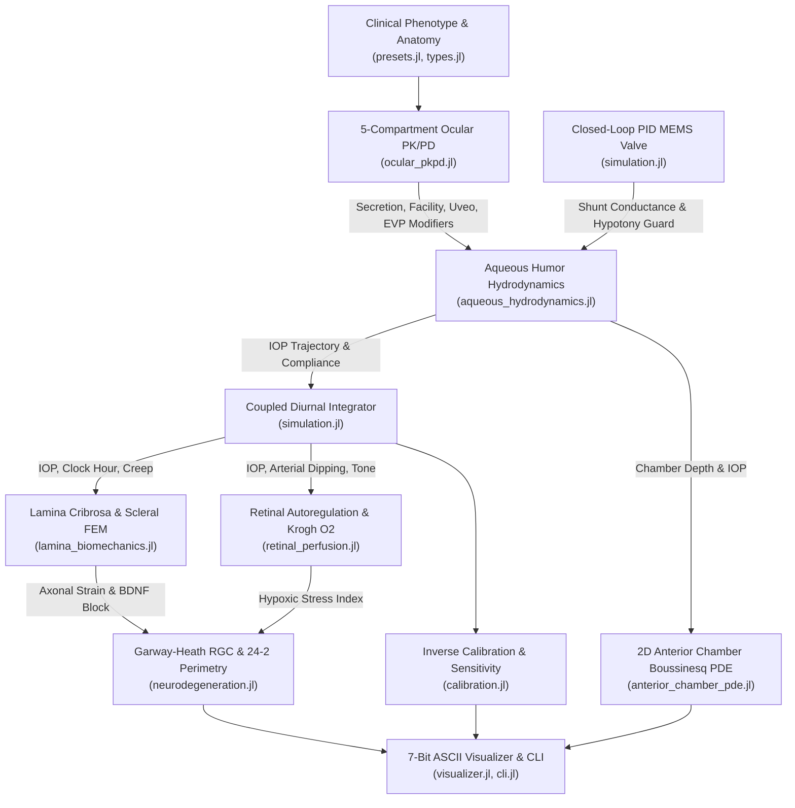
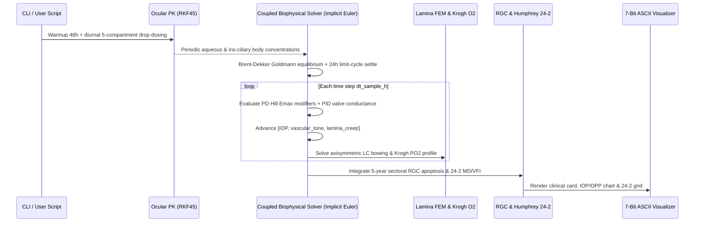

# IridisFlux

[](https://github.com/ZengLLQ/iridis-flux/actions/workflows/ci.yml)
[](https://github.com/ZengLLQ/iridis-flux)
[](LICENSE)
[](https://github.com/ZengLLQ/iridis-flux)

**Multiscale ocular biophysics simulator coupling aqueous humor hydrodynamics, anterior chamber thermal convection, lamina cribrosa poroviscoelasticity, retinal microvascular autoregulation, and glaucoma pharmacotherapy.**

---

## Executive Overview

Glaucoma is a coupled multiscale mechanobiological and neurovascular disease rather than a single-variable pressure disorder. Elevated intraocular pressure (IOP), nocturnal supine episcleral venous pressure elevation, Schlemm's canal collapse, low cerebrospinal fluid (CSF) intracranial pressure across the lamina cribrosa, systemic nocturnal arterial dipping, and impaired retinal autoregulation interact nonlinearly across timescales spanning **seconds** (anterior chamber thermal plumes and arteriolar Bayliss tone), **hours** (circadian aqueous humor dynamics and topical eye-drop pharmacokinetics), and **years** (retinal ganglion cell axonal degeneration and visual field loss).

**IridisFlux** models this full cascade from first-principles fluid mechanics, continuum shell biomechanics, reaction-diffusion mass transport, and compartmental pharmacodynamics:

1. **Circadian Aqueous Humor Hydrodynamics**: Non-linear Goldmann inflow-outflow ODE with Friedenwald exponential ocular rigidity, Schlemm's canal pressure-induced collapse, supine postural episcleral venous pressure shifts, pupillary-block angle-closure resistance, and Water-Drinking Test (WDT) provocative stress modeling.
2. **2D Sagittal Anterior Chamber Boussinesq Convection PDE**: Coupled streamfunction-vorticity Navier-Stokes, thermal energy advection-diffusion, and conservative finite-volume pigment/drug transport driven by the corneal-iris temperature gradient ($34.0^\circ\text{C}$ vs. $37.0^\circ\text{C}$).
3. **Poroviscoelastic Lamina Cribrosa & Fung Scleral Biomechanics**: Axisymmetric radial circular-plate bending-membrane discretization under the translaminar pressure gradient ($\text{TLPG} = (\text{IOP} - \text{ICP}) / h_{\text{LC}}$), coupled with Fung hyperelastic peripapillary hoop stretch, Kelvin-Voigt viscoelastic creep, and retrograde BDNF axoplasmic transport blockade.
4. **Retinal Microvascular Autoregulation & Krogh Oxygenation**: Dynamic arteriolar smooth-muscle tone ODE reproducing the Lassen autoregulation plateau and lower-limit ischemic collapse, coupled to a nonlinear 1D axisymmetric Krogh tissue cylinder oxygen diffusion-consumption boundary-value problem with Michaelis-Menten mitochondrial respiration.
5. **5-Compartment Ocular PK/PD & Multi-Drug Synergy**: Tear-film washout, corneal barrier permeation, aqueous turnover, iris-ciliary target binding, and vitreous sink dynamics for prostaglandin analogs (latanoprost), beta-blockers (timolol with nocturnal blunting), carbonic anhydrase inhibitors (dorzolamide), alpha-2 agonists (brimonidine neuroprotection), and Rho-kinase inhibitors (netarsudil).
6. **Garway-Heath Neurodegeneration & Humphrey 24-2 Perimetry**: Sectoral retinal ganglion cell (RGC) attrition mapped anatomically onto OCT RNFL thickness ($\mu\text{m}$) and a 52-point (54-location minus physiological blind spot) Humphrey 24-2 sensitivity grid ($\text{dB}$), Mean Deviation ($\text{MD}$), Pattern Standard Deviation ($\text{PSD}$), and Visual Field Index ($\text{VFI}\%$).
7. **Inverse Patient Calibration, Global Sensitivity & Closed-Loop MEMS Valve**: Bounded Levenberg-Marquardt parameter estimation from diurnal tonometry, Morris elementary-effects sensitivity ranking, and a discrete anti-windup PID glaucoma drainage valve controller with hypotony cutoff.

---

## System Architecture



### Coupled Execution Sequence



---

## Mathematical Formulations & Governing Equations

### 1. Circadian Aqueous Humor Dynamics & Schlemm's Canal Collapse

Intraocular pressure $P(t)$ (mmHg) evolves according to volume conservation modulated by Friedenwald's nonlinear ocular compliance $\frac{dV}{dP} = \frac{1}{K P}$:

$$\frac{dP}{dt} = 60 \, K \, P(t) \Big( F_{\text{in}}(t, P) - F_{\text{trab}}(t, P) - F_u(t) - F_{\text{valve}}(P) \Big)$$

where $K$ ($\mu\text{L}^{-1}$) is the Friedenwald rigidity coefficient and the factor $60$ converts $\mu\text{L}/\text{min}$ into $\text{mmHg}/\text{h}$.

- **Circadian Active Secretion & Pseudofacility**:

$$F_{\text{in}}(t, P) = F_{\text{base}} \left[ \left(1 - \frac{\sigma_{\text{noc}}}{2}\right) + \frac{\sigma_{\text{noc}}}{2} \cos\!\left(\frac{2\pi (h - h_\phi)}{24}\right) \right] (1 - E_{\text{sec}}) - C_{\text{ps}} (P - 15)$$

- **Schlemm's Canal Collapse & Trabecular Drainage**:

$$C_{\text{trab}}(P) = C_0 \, \gamma_{\text{drug}} \, (1 - \beta_{\text{block}}) \Big( 0.30 + 0.70 \exp\!\big(-\alpha_{\text{sc}} \max(P - P_{\text{crit}}, 0)\big) \Big)$$

$$F_{\text{trab}}(t, P) = C_{\text{trab}}(P) \max\!\big(P - P_{\text{ev}}(t), 0\big), \qquad P_{\text{ev}}(t) = P_{\text{ev},0} + s_{\text{sup}}(t)\Delta P_{\text{sup}} - E_{\text{evp}}$$

The $0.30$ collector-channel floor guarantees strict monotonicity of $F_{\text{trab}}(P)$ at extreme pressures while capturing the steep facility loss above $P_{\text{crit}} \approx 18\;\text{mmHg}$.

---

### 2. 2D Anterior Chamber Boussinesq Thermal Convection PDE

In the sagittal cross-section $(x, y) \in [0, W] \times [0, H]$ spanning corneal endothelium ($x = 0, T = 34^\circ\text{C}$) to warm iris ($x = W, T = 37^\circ\text{C}$), aqueous humor circulates via natural buoyancy:

$$\nabla^2 \psi = -\omega, \qquad u = \frac{\partial \psi}{\partial y}, \qquad v = -\frac{\partial \psi}{\partial x}$$

$$\frac{\partial \omega}{\partial t} + u \frac{\partial \omega}{\partial x} + v \frac{\partial \omega}{\partial y} = \nu_{\text{eff}} \nabla^2 \omega + g \beta \frac{\partial T}{\partial x}$$

$$\frac{\partial T}{\partial t} + u \frac{\partial T}{\partial x} + v \frac{\partial T}{\partial y} = \alpha_{\text{th}} \nabla^2 T$$

$$\frac{\partial c}{\partial t} + \frac{\partial (u c)}{\partial x} + \frac{\partial \big((v - v_{\text{settle}}) c\big)}{\partial y} = D_c \nabla^2 c$$

The elliptic streamfunction equation is solved at each step with Successive Over-Relaxation (SOR, $\omega_{\text{SOR}} = 1.72$) and Thom's wall vorticity boundary conditions, while pigment/drug transport uses conservative finite-volume upwind fluxes with zero-flux Neumann walls.

---

### 3. Fung Scleral Shell & Axisymmetric Lamina Cribrosa Biomechanics

The peripapillary sclera carries Laplace hoop stress $\sigma_\theta = \frac{P \, R_{\text{globe}}}{2 \, h_{\text{sclera}}}$ governed by a Fung exponential constitutive law:

$$\sigma_\theta = \frac{E_{\text{scl}}}{\beta_{\text{Fung}}} \big(e^{\beta_{\text{Fung}} \varepsilon_\theta} - 1\big) \implies \varepsilon_\theta = \frac{1}{\beta_{\text{Fung}}} \ln\!\left(1 + \frac{\beta_{\text{Fung}} \sigma_\theta}{E_{\text{scl}}}\right)$$

Driven by the translaminar pressure gradient $\text{TLPG} = \frac{\text{IOP} - \text{ICP}(t)}{h_{\text{LC}}}$, the circular lamina cribrosa plate bends posteriorly under coupled flexural rigidity $D_{\text{LC}} = \frac{E_{\text{LC}} h_{\text{LC}}^3}{12(1 - \nu^2)}$ and scleral canal tension $T_r = \frac{E_{\text{LC}} h_{\text{LC}} \varepsilon_\theta}{1 - \nu}$:

$$-\left(T_r + \frac{8 D_{\text{LC}}}{R_{\text{LC}}^2}\right) \left(\frac{d^2 w}{dr^2} + \frac{1}{r}\frac{dw}{dr}\right) = \text{IOP} - \text{ICP}, \qquad w'(0) = 0, \quad w(R_{\text{LC}}) = 0$$

Effective von Mises axonal strain $\varepsilon_{\text{eff}} = \sqrt{\varepsilon_r^2 + 0.75 \, \gamma_{rz}^2}$ induces retrograde BDNF transport blockade via a cubic Hill law.

---

### 4. Retinal Autoregulation & Krogh Tissue Cylinder Oxygenation

Ocular perfusion pressure $\text{OPP}(t) = P_{\text{oph}}(t) - P(t)$ drives arteriolar vascular conductance $G_{\text{norm}}$ through a dynamic smooth-muscle tone ODE with time constant $\tau_{\text{auto}}$:

$$\tau_{\text{auto}} \frac{dG}{dt} = G_{\text{eq}}(\text{OPP}) - G, \qquad Q_{\text{ONH}} = Q_0 \, G \, \frac{\text{OPP}}{\text{OPP}_0}$$

Oxygen diffuses radially from capillary radius $r_{\text{cap}}$ to outer Krogh radius $r_{\text{Krogh}}$ under Michaelis-Menten mitochondrial respiration:

$$\frac{D_{\text{eff}}}{r} \frac{d}{dr}\left(r \frac{d P_{\text{O}_2}}{dr}\right) = \frac{M_{\max} P_{\text{O}_2}}{K_m + P_{\text{O}_2}}, \qquad P_{\text{O}_2}(r_{\text{cap}}) = P_{\text{cap}}(Q_{\text{ONH}}), \quad \left.\frac{dP_{\text{O}_2}}{dr}\right|_{r_{\text{Krogh}}} = 0$$

Distal hypoxia below $22\;\text{mmHg}$ feeds directly into the Hypoxic Stress Index ($\text{HSI}$).

---

### 5. 5-Compartment Ocular PK/PD & Bliss Combination

Each ophthalmic drop instillation injects a smooth Gaussian bolus into the tear film ($V_{\text{tear}} = 7\;\mu\text{L}$), permeating serially across cornea $\leftrightarrow$ aqueous $\leftrightarrow$ iris-ciliary body $\to$ vitreous:

$$\frac{dm_{\text{tear}}}{dt} = I_{\text{drop}}(t) - (k_{\text{drain}} + k_{tc}) m_{\text{tear}}, \qquad E_i = \frac{C_{\text{icb},i}^{n_i}}{\text{EC}_{50,i}^{n_i} + C_{\text{icb},i}^{n_i}}$$

Multi-agent suppression combines via Bliss independence, with circadian nocturnal blunting applied specifically to $\beta$-adrenergic blockade.

---

## Subsystem Directory Map

| Module | File | Responsibility & Core Algorithms |
| :--- | :--- | :--- |
| Type System | [`src/types.jl`](src/types.jl) | Physical parameter structs, clinical phenotype bundles, PDE/FEM/Perimetry output types |
| Numerical Kernels | [`src/numerics.jl`](src/numerics.jl) | Cash-Karp RKF45 + cubic Hermite dense output, Backward Euler, Crank-Nicolson, 2D SOR, Brent-Dekker, Levenberg-Marquardt, Welford, Morris sensitivity |
| Aqueous Dynamics | [`src/aqueous_hydrodynamics.jl`](src/aqueous_hydrodynamics.jl) | Circadian secretion, Schlemm's canal collapse, supine EVP, Friedenwald rigidity, WDT stress |
| Anterior PDE | [`src/anterior_chamber_pde.jl`](src/anterior_chamber_pde.jl) | 2D sagittal Boussinesq streamfunction-vorticity + conservative tracer transport |
| Lamina Mechanics | [`src/lamina_biomechanics.jl`](src/lamina_biomechanics.jl) | TLPG, Fung scleral hoop mechanics, radial circular-plate FEM, BDNF transport block |
| Retinal Perfusion | [`src/retinal_perfusion.jl`](src/retinal_perfusion.jl) | Ophthalmic MAP, Lassen autoregulation ODE, nonlinear Krogh radial $\text{O}_2$ BVP |
| Ocular PK/PD | [`src/ocular_pkpd.jl`](src/ocular_pkpd.jl) | 5-compartment topical PK, Hill $E_{\max}$ & Bliss drug interaction, nocturnal blunting |
| Neurodegeneration | [`src/neurodegeneration.jl`](src/neurodegeneration.jl) | 6 Garway-Heath ONH sectors, OCT RNFL thinning, 52-point Humphrey 24-2 MD/PSD/VFI |
| Coupled Simulator | [`src/simulation.jl`](src/simulation.jl) | Diurnal multi-physics integrator + anti-windup PID MEMS drainage valve |
| Patient Calibration | [`src/calibration.jl`](src/calibration.jl) | Inverse LM outflow calibration, Morris sensitivity ranking, clinical staging |
| Clinical Presets | [`src/presets.jl`](src/presets.jl) | 5 clinical phenotypes (`healthy`, `poag`, `ntg`, `aacc`, `pxfg`) + 5 drug profiles |
| ASCII Visualizer | [`src/visualizer.jl`](src/visualizer.jl) | Strictly 7-bit ASCII charts, 2D convection maps, lamina bars, 24-2 grids |
| CLI Dispatcher | [`src/cli.jl`](src/cli.jl) | `simulate`, `anterior`, `calibrate`, `benchmark`, `inspect` / `demo` subcommands |

---

## Installation & Quick Start

Requires Julia `>= 1.10` (standard library dependencies only: `LinearAlgebra`, `Statistics`, `Random`, `Printf`, `Dates`, `Test`).

```bash
git clone https://github.com/ZengLLQ/iridis-flux.git
cd iridis-flux

# Run the complete unit, conservation, convergence, and CLI test suite
julia --project=. -e "using Pkg; Pkg.test()"
```

### CLI Usage Reference

```bash
# 1. Coupled 24h POAG simulation + Latanoprost + 5-year progression + ASCII plots
julia --project=. bin/iridisflux.jl simulate --phenotype poag --drug latanoprost --hours 24 --years 5 --plot

# 2. Closed-loop PID MEMS drainage valve targeting 13.0 mmHg
julia --project=. bin/iridisflux.jl simulate --phenotype pxfg --valve --target-iop 13.0 --plot

# 3. 2D sagittal anterior chamber Boussinesq convection & pigment dispersion
julia --project=. bin/iridisflux.jl anterior --phenotype aacc --steps 120 --plot

# 4. Inverse Levenberg-Marquardt patient outflow calibration from diurnal tonometry
julia --project=. bin/iridisflux.jl calibrate --phenotype poag

# 5. Numerical convergence & Morris global sensitivity benchmark
julia --project=. bin/iridisflux.jl benchmark

# 6. Clinical phenotype & visual field inspection
julia --project=. bin/iridisflux.jl inspect --phenotype ntg --plot
```

### Julia API Walkthrough

```julia
using IridisFlux

patient = get_phenotype("poag")
regimen = get_regimen("max") # Latanoprost + Netarsudil + Brimonidine

# Run 48-hour coupled diurnal simulation
res = simulate_diurnal(patient; regimen = regimen, duration_h = 48.0)

# Project 5-year Garway-Heath RGC & Humphrey 24-2 progression
prog = simulate_long_term_progression(patient, res; years = 5.0, neuroprotection_bonus = 0.22)
risk = assess_glaucoma_risk(patient, res, prog)

println(render_clinical_card(patient, res, prog, risk))
println(render_visual_field_24_2(prog.final_visual_field))
```

---

## Standalone Runnable Examples

```bash
julia --project=. examples/01_diurnal_iop_pharmacotherapy.jl
julia --project=. examples/02_anterior_chamber_convection.jl
julia --project=. examples/03_translaminar_ntg_progression.jl
```

---

## Sample 7-Bit ASCII Visualization Output

```text
+------------------------------------------------------------------+
| IRIDISFLUX CLINICAL DIAGNOSTIC & PROGNOSIS REPORT                |
+------------------------------------------------------------------+
| Patient Phenotype : Primary Open-Angle Glaucoma (POAG)           |
| Therapy Regimen   : Latanoprost 0.005% QHS                       |
| Risk Stage        : Physiologically Stable / Low Risk            |
| Primary Driver    : Mixed Biomechanical Lamina Strain & Ischemic |
+------------------------------------------------------------------+
| IOP (Mean / Peak / Swing): 18.40 / 22.24 / 11.16 mmHg            |
| Minimum Nocturnal OPP    : 38.96 mmHg                            |
| Peak Lamina Bowing       : 52.08 um (Strain: 0.0510)             |
| Mean ONH Hypoxic Stress  : 0.000 (Min PO2: 40.5 mmHg)            |
| 5-Year RNFL Thickness    : 85.7 um (Start: 94.0 um)              |
| 5-Year 24-2 MD / VFI     : -1.86 dB (-0.37 dB/yr) | VFI 93.8%    |
+------------------------------------------------------------------+
```

---

## Numerical Convergence & Verification Benchmarks

| Benchmark / Verification Check | Numerical Method | Measured Behavior |
| :--- | :--- | :--- |
| Exponential Decay ($\lambda = -0.35$) | Adaptive Cash-Karp RKF45 + Cubic Hermite | Endpoint absolute error $< 10^{-8}$ |
| Stiff Decay ($\lambda = -50$) & Order Check | Implicit Backward Euler / Crank-Nicolson | Unconditionally positive; empirical order $\approx 2.00$ |
| 2D Elliptic Poisson Manufactured Soln. | SOR ($\omega = 1.72$) on $21 \times 21$ | Max grid error $< 2.1 \times 10^{-3}$ |
| Goldmann Steady-State Equilibrium | Bracketed Brent-Dekker Root Finder | Residual $|F_{\text{in}} - F_{\text{trab}} - F_u| < 10^{-6}\;\mu\text{L}/\text{min}$ |
| Outflow Facility Recovery ($C_0, F_u, \alpha$) | Bounded Levenberg-Marquardt | Tonometry fit RMSE $< 0.05\;\text{mmHg}$, $< 5\%$ parameter error |

---

## Architectural Trade-Offs & Known Limitations

1. **Axisymmetric Lamina Cribrosa Approximation**: The radial circular-plate discretization captures central posterior bowing, scleral canal hoop tension, and peak insertion shear efficiently in sub-millisecond time, but omits 3D quadrant-specific collagen beam anisotropy and focal inferior/superior laminar pores.
2. **2D Planar Anterior Chamber Geometry**: The sagittal Boussinesq PDE models vertical gravity-driven thermal plumes and corneal endothelial pigment sedimentation without full 3D circumferential iris-crypt and lens-iris channel flow.
3. **Lumped Krogh Capillary Cylinder**: Tissue oxygenation assumes a uniform inter-capillary spacing ($r_{\text{Krogh}} = 28\;\mu\text{m}$) along the optic nerve head prelaminar/laminar capillary bed rather than an anatomically segmented microvascular network.
4. **Pure Standard-Library Numerics**: Deliberate avoidance of external differential-equation or plotting packages ensures deterministic builds and fast execution across Linux, macOS, and Windows CI runners without binary artifact fragility.

---

## License

Released under the [MIT License](LICENSE).
